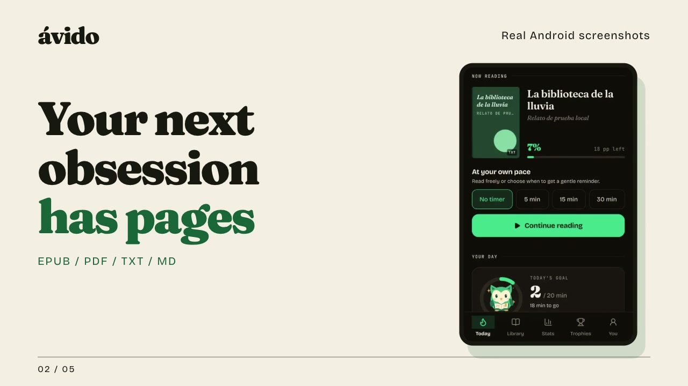
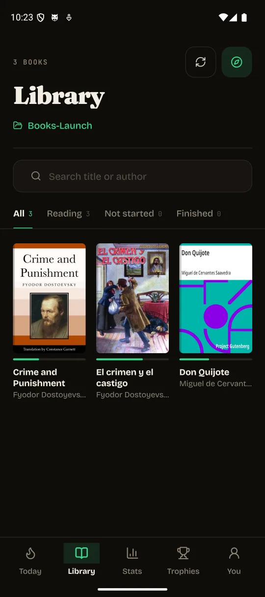
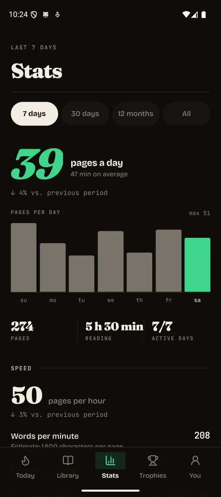
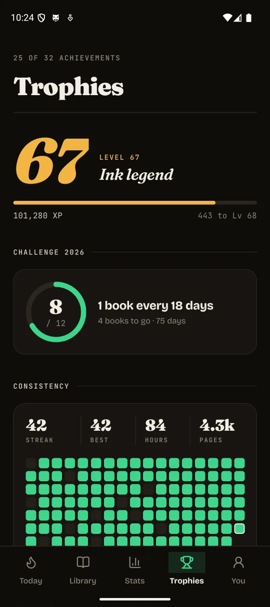
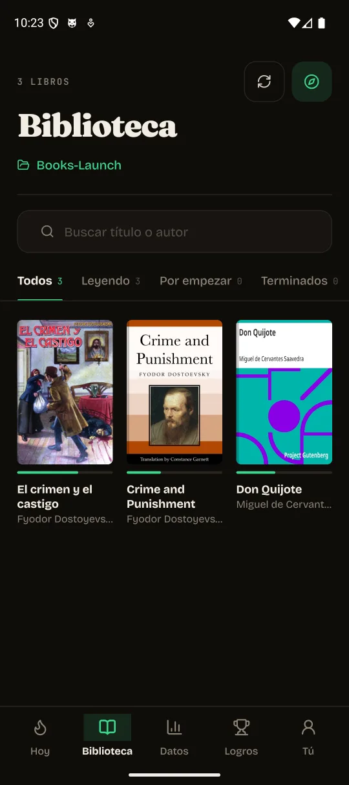
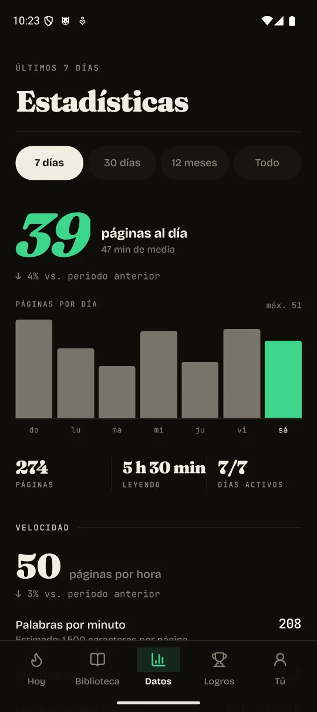
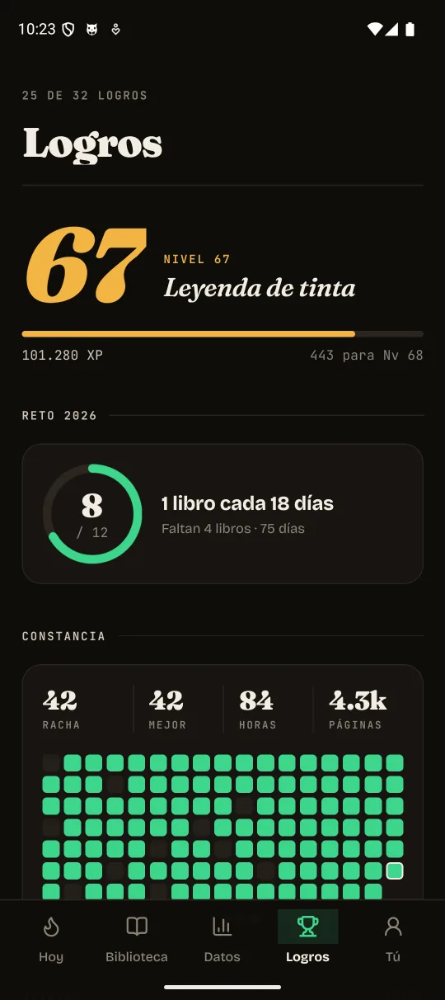

# 📚 Ávido

### Get hooked on books

**A private Android reader that makes coming back to a book feel good**

Silicon Valley made a fortune getting us hooked on feeds. Ávido borrows the streaks, rewards and little wins — and puts them to work for your next chapter.

Read a few pages, earn XP and watch your progress grow. Your books and reading history stay on your device, with no account, ads or analytics.

[⬇️ Download Android APK](https://github.com/alexfdez1010/avido/releases/latest/download/avido.apk) · [🌍 Explore the website · ES / EN](https://avido.alejandrofernandezcamello.me/) · [🤝 Contribute](CONTRIBUTING.md)

Android · Spanish & English · Free & open source · MIT licensed

## 🎬 Meet Ávido in 33 seconds

[](https://avido.alejandrofernandezcamello.me/en/#film-heading)

[▶️ Watch in English](https://avido.alejandrofernandezcamello.me/en/#film-heading) · [▶️ Ver en español](https://avido.alejandrofernandezcamello.me/es/#film-heading) · [Download the video](https://avido.alejandrofernandezcamello.me/assets/avido-launch-en.mp4)

[Music and credits](site/assets/video-credits.txt).

## 👀 Your library, your progress

<p align="center">
  <a href="site/assets/screenshots/en/library.webp"></a>
  <a href="site/assets/screenshots/en/stats.webp"></a>
  <a href="site/assets/screenshots/en/trophies.webp"></a>
</p>

<details>
<summary>Ver las capturas en español</summary>

<p align="center">
  <a href="site/assets/screenshots/es/library.webp"></a>
  <a href="site/assets/screenshots/es/stats.webp"></a>
  <a href="site/assets/screenshots/es/trophies.webp"></a>
</p>

</details>

More screens: [English](https://avido.alejandrofernandezcamello.me/en/#screenshots) · [Español](https://avido.alejandrofernandezcamello.me/es/#screenshots)

## 🔥 Make the next chapter easier to start

- **Feel every little win** — Earn XP, level up and unlock 32 achievements as you read.
- **Find your own rhythm** — Choose a daily goal, build a streak and let streak freezes cover an occasional missed day.
- **See how far you've come** — Follow your reading activity and work towards your yearly book challenge.
- **Have a reason to return** — Three daily quests and Miga, your little reading companion, add a playful nudge.

## 📖 Make yourself comfortable

- **Bring your bookshelf** — Open EPUB, PDF, TXT and Markdown books from a folder on your device.
- **Make the page yours** — Choose fonts, themes and spacing for reflowable books, or read PDFs page by page.
- **Pick up where you left off** — Your place is saved for each book.
- **Read on e-ink** — A monochrome mode, reduced motion and tap-to-turn pages suit Android e-ink devices.
- **Find your next classic** — Browse and download from Project Gutenberg without leaving the app.

The app follows your device language: Spanish (Spain) or English, with English as the fallback. Bring books without DRM, and check the copyright status of Gutenberg titles where you live. Releases are currently available for Android.

## 🔒 Keep your reading to yourself

No account to create. No ads between chapters. No analytics recording your reading habits. Your library, progress and preferences are stored on your device, and you can read local books offline.

Discover needs the internet and connects to Project Gutenberg. For details about permissions, local storage and device backups, read the [privacy guide](docs/privacy.md).

Open source under [MIT](LICENSE), so you can see how it works, make it yours and help make it better.

## ⬇️ Three steps to your next book

1. **Download** — On your Android device, tap [Download Android APK](https://github.com/alexfdez1010/avido/releases/latest/download/avido.apk). If your browser asks whether to keep the APK, confirm the download.
2. **Install** — Open `avido.apk` from your downloads. If Android asks, open **Settings**, enable **Allow from this source** for the browser or file app you are using, then return and tap **Install**. You can turn that permission off again afterwards. Labels vary by Android version.
3. **Read** — Open Ávido, choose your books folder and set your daily goal. Open a book, or find a classic in Discover.

No computer or developer tools needed. You can also get the APK from the [latest release page](https://github.com/alexfdez1010/avido/releases/latest).

If the folder picker doesn't work on your device, use the in-app storage browser. This fallback requests broader file access, explained in the [privacy guide](docs/privacy.md).

## 🛠️ Build it yourself

Use Node.js 22 and npm. For a local Android build, also install JDK 17 and the Android SDK, and connect a device or start an emulator.

```bash
git clone https://github.com/alexfdez1010/avido.git
cd avido
npm ci
npm run android
```

Ávido uses native modules, so Android development requires a development build rather than Expo Go. To restart the development server after installing that build:

```bash
npm start -- --dev-client
```

Run the project checks before submitting changes:

```bash
npm run typecheck
npm run lint
npm test
```

`android/` and `ios/` are generated native projects. Configure native behavior in `app.config.ts` and `plugins/`; do not edit generated files by hand. See [CONTRIBUTING.md](CONTRIBUTING.md) for the development workflow and [Android testing](docs/android-testing.md) for device validation.

## 🤝 Help more people fall for reading

Help improve the reader, make e-ink support more reliable, refine translations, fix an accessibility issue or report a book that doesn't render correctly. Small, focused contributions are welcome.

Before starting a large change, [open an issue](https://github.com/alexfdez1010/avido/issues) to discuss it. Please don't attach copyrighted books or private reading data to public reports.

## 🧭 Documentation

- [Contributing](CONTRIBUTING.md) — setup, checks and pull requests.
- [Privacy](docs/privacy.md) — local data, permissions and network connections.
- [Architecture](docs/architecture.md) — project layout, data flow and persistence.
- [Gamification](docs/gamification.md) — XP, levels, streaks, quests and achievements.
- [Habit design](docs/habit-loop.md) — product intent and the limits of outcome claims.
- [Internationalization](docs/i18n.md) — Spanish and English UI strings.
- [Android testing](docs/android-testing.md) — emulator and device verification.
- [Releasing](docs/releasing.md) — CI builds, versioning and signing.
- [GitHub Pages](docs/github-pages.md) — the bilingual website and deployment.

Built with Expo SDK 57, React Native, Expo Router, TypeScript, Zustand, Reanimated, FlashList and gluestack-ui.

## ⚖️ License

Ávido's source code is available under the [MIT license](LICENSE). Dependencies, bundled fonts and books retain their respective licenses and copyright terms.
